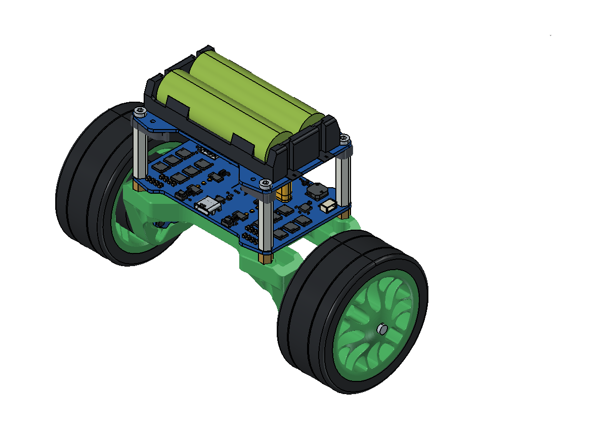

# ZD2808 两轮平衡车

FreeCAD工程、分件实测质量和机械参数，以及MATLAB、ROS2、Gazebo、MuJoCo模型。



当前整车计重402.5g：车身277.1g，两侧旋转组各62.7g。惯性参数来自实测质量与FreeCAD几何分布估算，尚未通过实物惯量辨识。

## 获取模型

本仓库使用Git LFS保存FreeCAD工程和仿真网格。先安装Git LFS，再克隆：

```bash
git lfs install
git clone https://github.com/BGzEroll/foc_balance_car.git
cd foc_balance_car
git lfs pull
```

GitHub网页上的“Download ZIP”是否包含LFS实体文件取决于仓库设置；需要原生工程与仿真网格时，建议用上述方式克隆。

完整高精度STEP/STL/OBJ导出包放在 [Releases](https://github.com/BGzEroll/foc_balance_car/releases/tag/v1.0.0)，下载后在仓库根目录解压，会恢复到 `模型/导出的模型/`。这些CAD导出采用毫米单位；仿真模型采用米、千克、秒。

## 文件入口

MATLAB三维动力学仿真：初次使用打开 [`matlab/launch_balance_panel.m`](matlab/launch_balance_panel.m)，点击MATLAB的“运行”，用中文面板选择动作，再更新原生3D动画。控制器采用六状态LQR；模型使用三刚体、六自由度基座和轮地接触，包含行驶、转向、外力与起伏地形；详细说明及命令入口见 [`matlab/README.md`](matlab/README.md)。

| 入口 | 用途 |
|---|---|
| [模型说明](模型/README_从这里开始.md) | 工程树、坐标、质量口径、建模假设和各软件使用说明 |
| [模型档案](模型/平衡车模型档案.xlsx) | 四视图、尺寸、称重及俯仰/偏航参数 |
| `模型/freeCAD工程/平衡车_最终.FCStd` | 继续建模；车身与两侧旋转组分层 |
| `模型/仿真模型/` | URDF、ROS2描述包、SDF、MuJoCo和MATLAB入口 |
| `模型/参数与图片/` | 机械参数与验证记录 |
| `模型/源数据与依据/整理前_R6.FCStd` | 整理前完整元件模型 |

已完成FreeCAD装配关系核对、STEP回读、MATLAB URDF导入、MuJoCo短时步进和Simscape Multibody三维平衡恢复验证。ROS2/Gazebo尚未实际启动；接触、驱动和传感器参数仍需按实物标定。

## 文件管理

- 普通Git：代码、说明、参数、图片和Excel。
- Git LFS：原生FreeCAD工程及仿真网格；修改后正常 `git add` / `git commit` / `git push`。
- Releases：完整高精度CAD导出，避免将大型生成文件反复写入Git历史。
- 本地保留：FreeCAD自动备份、缓存和过程记录，由 `.gitignore` 排除。

上游模型来自 [立创开源广场原项目](https://oshwhub.com/yeharold/foc-balance-caresp32s3arduino)，装配、尺寸与质量根据实物补充。详细来源见模型说明。
