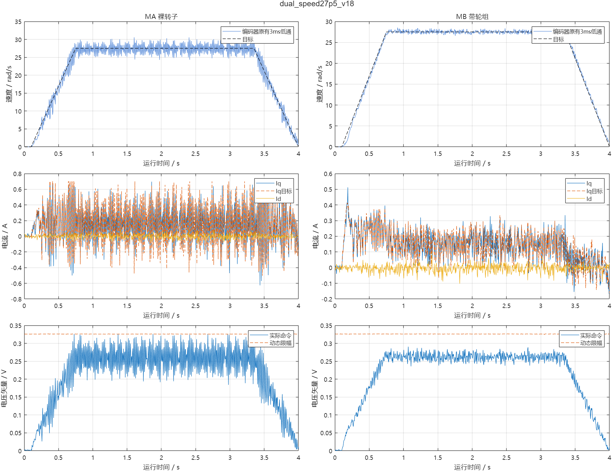

# 双电机、动态母线限幅与车型速度范围实测

后续已完成[事件等待与任务拆分对照](../event_driven/README.md)，未发现直接拆分的性能收益，最终恢复本页v18作为默认基线。本文中的“建议进行架构对照”已落实，具体选择以新报告为准。

日期：2026-10-19。开发机分支 `test/foc_current`，原作者工程未修改。

当前最终固件为v18，已烧录并完成双电机阶跃、10rad/s和正反27.5rad/s复测。最后再次打开串口后确认 `running=0`、`requested=0`，母线8.139V；复位默认停止且两台零位均未授权。没有合入main，没有进入落地平衡。

实物由用户确认：车架架空、MA无轮、MB带轮，两侧自由转动。全部运行命令有限时；默认停止，每轮先STOP、核对传感器、设置参数，结束确认停止后才导出。

## 车型与负载依据

当前机械参数：半径0.0325 m、整车0.4025 kg、MB完整旋转组0.0627 kg、自转惯量约2.99679e-5 kg m²。参考 `模型/参数与图片/机械参数.json` 和 `model_reference.json`。

模型常规速度参考上限0.35 m/s，对应10.77 rad/s；快速档0.90 m/s对应27.69 rad/s。这些是仿真控制器参数，不是实车认证速度。计划按5、10、15、20、27.5 rad/s逐级测试；有保护、持续失步或跟踪异常则停止升级。

架空MB只施加真实轮组旋转惯量和自身摩擦，不包含整车平动、滚阻或平衡负载。不能把MA裸转子套用完整轮组惯量，也不能把架空双电机通过等同于落地平衡通过。按标称KV推算的Kt仅用于加速量级估计，未作转矩标定。

## 动态电压上限

每个有效样本使用其母线ADC值计算 `Vlimit = min(实验绝对上限, ratio * Vbus)`；当前ratio只允许0.005～0.04，绝对实验上限最多0.4 V。实际输出仍远低于整段母线可调制电压，限制来自本轮实验范围和固定低侧采样窗口。不能将本方案的0.04误写成常规SVPWM全调制系数。

PI使用当轮有效上限作矢量缩放和积分回算；v16起静态校准电压也经过同一个动态限幅。母线约1kHz测量，越界或停更停止；没有通过提高电压限幅绕过电流保护。实际母线不能由本软件主动调节，电压变化范围以每轮ADC记录为准；没有进行可编程电源扫压。

首轮MA基线：母线7.974～8.022 V，0.30 A指令平台约0.2990 A，标准差17.0 mA；3499/3499组有效。上限实测随母线在0.11961～0.12000 V变化，无输出越界。MA另完成10 rad/s、2秒测试，19999/19999组有效，无保护。

## 双电机采样时序的实际取舍

v13/v14试过每PWM周期连续采MA A/B及MB A/B。单路ADC转换加数据处理挤压后两路窗口：v14 MB校准只有8675/8998组通过。另修正了控制任务先取now、随后读取更新后的母线时间戳导致无符号下溢的竞争；应先读取时间戳，再读取当前时刻。失败数据仍保留。

v15改为10 kHz PWM，逐周期交替MA和MB，每电机5 kHz采样。电流PI只消费新且有效的完整A/B组，按实际dt积分；C相重构。两台电机独立维护采样序号、积分、电角度零位、PI统计和原始电流极值。六个MCU PWM输出仍是每电机三路，不是手工驱动六路互补。

MB 0.10 V静态矢量复核：4500/4500组通过窗口判断，最小保存有效窗口余量7.8375 μs；A/B电流极性与坐标一致，α→β机械角差约0.21939 rad，7极对理想值0.22440 rad；临时电角度零位2.164932114 rad、方向+1。临时零位仍包含齿槽与静摩擦误差。

提取实际调制函数执行5216400个母线/角度/限幅组合测试，验证线电压量化误差及名义低侧入口余量。该检查不代替示波器确认运放建立时间、死区和实际栅极波形。

## FOC与sensor任务是否拆开

后续决定：用户已确定本阶段采用v18合并轮询，开始[PI参数与工况对照](../pi_tuning/README.md)。下面保留首次双电机测试时提出架构对照的历史理由；架构对照已完成，不再作为当前待办。

本轮保留合并任务完成双电机基线。台架测试可以继续使用；正式控制建议对“事件驱动拆分”进行下一轮对照。合并减少快照和任务切换开销，但I²C完成处理、IMU计算会增加PI延迟；拆分可能使新电流更快得到处理，也会引入抢占、通知和共享数据成本，不能仅凭任务数量断言更快。

若后续拆分，建议一个消费两台电机反馈的FOC任务和一个拥有I²C状态机的sensor任务。FOC被新有效采样唤醒、处理最新快照，无新工作就阻塞；sensor也在完成事件/超时上等待。维持每电机实际dt、编码器新鲜度检查、停机后恢复、完整三相命令提交和控制进度监测。

不能把高优先级常驻FOC循环中的 `taskYIELD()` 当成向低优先级sensor交棒：调度器仍选最高优先级的就绪任务。[FreeRTOS原始说明](https://www.freertos.org/FreeRTOS_Support_Forum_Archive/February_2007/freertos_taskYIELD_from_highest_priority_task._1663277.html)。双电机基线应比较最大PI间隔、编码器年龄、提交错过率、保护事件和带载电流误差，再决定是否进行架构对照。

实测依据：最终v18三轮速度测试最大PI有效更新间隔为400/400/600μs，编码器最大年龄1.087ms，仍小于1.5ms停机阈值；新命令首次生效的全速统计平均约151～156μs、最大369μs。每轮4秒/40000个PWM周期错过提交时隙442～673次（约1.11%～1.68%），均保留旧整组命令。拆分值得评估，但不宣称已解决这些抖动。每电机5kHz是采样频率，不能宣称PI严格每200μs执行。

`LATENCY`计数仅在一个新采样命令首次被TEZ应用时计入，适合比较计算/提交路径；`max_latch_age_us`及CSV中的当前latch时间还包含旧命令被后续周期继续保持的年龄，不能混为首次响应延迟。

v18另在PWM TEZ回调检查各启用电机的最后有效采样，超过1ms停止，覆盖“FOC心跳仍更新但采样完全停更”的遗漏。提取真实TEZ回调并替换外设读写后，10个主机故障用例通过，包括MA/MB停更、未启用电机、启动、32位时间回绕、任务/母线停更和限时停止；这不是板上故障注入。Idle1看门狗配置沿用原设置，本轮没有把软件进度保护等同于硬件限流。

## 双电机实测结果

完整v17阶梯每轮4秒：5、10、−10、15、20、27.5、−27.5rad/s全部通过程序的升级门控；v18增加独立反馈超期监测后，再做双电机0.30A阶跃和10、±27.5rad/s复测。下表优先使用v18；5/15/20档为v17。

| 目标rad/s | 轮缘等效m/s | MA平台平均rad/s | MB平台平均rad/s | 版本 |
|---:|---:|---:|---:|---|
| 5 | 0.1625 | 4.9589 | 5.0046 | v17 |
| 10 | 0.3250 | 9.8447 | 10.0093 | v18 |
| 15 | 0.4875 | 14.9771 | 15.0063 | v17 |
| 20 | 0.6500 | 19.9387 | 20.0123 | v17 |
| 27.5 | 0.89375 | 27.4725 | 27.5104 | v18 |
| −27.5 | −0.89375 | −27.4417 | −27.5080 | v18 |

速度均值使用平台1.0秒以后、减速之前的机械角度线性拟合。当前正负号是各电机校准后的电角/转矩坐标；这不是已经验收的整车前进方向映射。进入车辆控制前仍需按MA左、MB右与模型的前进轴逐侧核对。

最终v18的全速控制统计：

| 工况 | MA Iq误差RMS | MB Iq误差RMS | MA/MB有效窗口 |
|---|---:|---:|---|
| 10rad/s | 69.2mA | 35.8mA | 19983/19999；20000/20000 |
| +27.5rad/s | 94.9mA | 60.5mA | 19997/19999；20000/20000 |
| −27.5rad/s | 94.9mA | 57.3mA | 19999/19999；19999/20000 |

三轮均无比较值API错误、跨TEZ或保护停机；窗口不合格组被拒绝。最终最快两轮母线保存范围约8.103～8.166V，动态电压上限约0.324～0.327V，没有保存输出超过对应限幅。MA高速平台有约1.52%/2.30%的电压饱和，MB没有平台电压饱和；因此不能宣称MA已在该档完成高精度电流整定。保留无额外电流滤波，速度仍用原3ms低通，IMU原有滤波也保留。

v18双电机0.30A阶跃平台：MA/MB均值0.299980/0.299897A、标准差15.3/18.8mA，未饱和。所有电流统计仍是标称安培换算。

4秒数据按每25组抽取一组，约每电机200Hz。抽取与PWM/控制纹波可能混叠，CSV再算的电流均值/RMS会与全速统计不同；上表电流指标采用板上每次有效PI更新累计的 `METRIC`，速度拟合与图表采用保存样本。A/B全速原始极值有单独计数；C相未直接测量。不能用200Hz曲线证明所有5kHz样本的瞬时峰值。



## 最终参数、源码与复现

```text
PWM = 10kHz, counter = 80MHz, A/B sample = 5kHz per motor
ADC trigger = TEZ+30us, comparator commit = TEZ+80us
Current PI Kp = 0.060318579 V/A, Ki = 226.194672 V/(A*s), Tf = 0
Velocity PI Kp = 0.20 A/(rad/s), Ki = 0.40 A/rad, Iq limit = +/-0.70A
MA theta = wrap(-7*left_encoder_angle - 5.330672807)
MB theta = wrap(+7*right_encoder_angle - 2.164932114)
Speed bench limit = 28rad/s, overspeed stop = 40rad/s
Current-feedback expiry = 1ms, encoder expiry = 1.5ms
Default bus ratio / absolute cap = 0.015 / 0.12V
Fast test bus ratio / absolute cap = 0.04 / 0.40V
```

本地完整工程 `esp32/balance_car/user_lib/foc_current.cpp`、`foc_current.h`、`test.cpp`及`hw/sensor.cpp/.h`已与开发机当前源码逐字节同步；其他构建输入核对时仅有Windows换行差异。当前入口仍是有限时实验控制台，没有改成整车应用。

最终实测固件 `tested_v18.bin` SHA256：
`1e18d3630090170f852070ce64e3f7b59fa2f04d27361591e393cffa3cfbc1f6`

最终电流环源码 SHA256：
`a3ca809fa2a8ea6f3fe81d160bbd2c6148a42a39b1d5779851518185498d8c32`

`matrix_summary.json`保存完整阶梯，`matrix_summary_v18.json`保存最终固件复测。`run_dual.py`会等待IMU完成1000组静止校准后才运行；早期v17的5/10档启动时尚无此等待，当前FOC不使用IMU，这两轮不能用于IMU/平衡控制验收。

离线MATLAB绘图：`addpath('D:/code/Embedded-related/balance_car/esp32/current_loop/dual_bus'); plot_results`。PNG及原生FIG均已保存；所有分析脚本不启动电机。开发机完整旧版本备份位于 `esp32/balance_car/build/current_dual/before/`，本地保留关键版本源码与实测镜像。

## 证据文件

- `prepare_bus.py`、`foc_current.cpp`：v12 MA动态限幅生成器及源码。
- `prepare_dual.py`、`dual_foc_current.cpp`：双电机实验生成器及源码。
- `run.py`、`run_dual.py`：有限时硬件实验，导出前后确认停止。
- `inspect_data.py`、`calibrate_mb.py`：只读离线分析，不接串口。
- `check_policy.py`、`policy_test.cpp`：从真实调制函数生成的离线组合检查。
- 每轮 `.csv/.json/.log`：样本、ADC LUT、全速ISR统计和串口原文。

电流换算仍使用标称增益±4 A/V，±2 A停机是采样后的软件保护；窗口有效指软件判定。所有后续结果以对应实测文件为依据。
