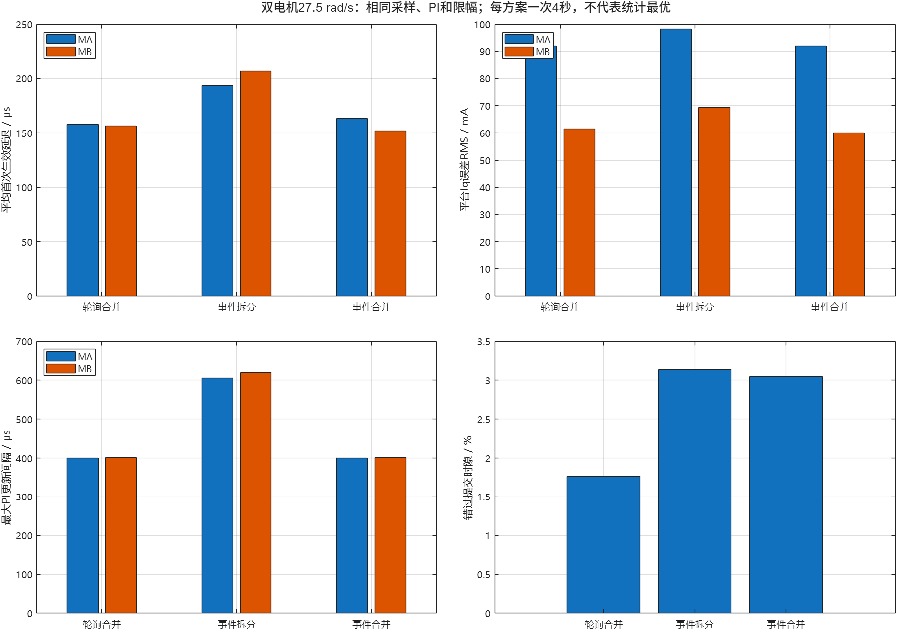

# 事件等待与FOC/sensor任务拆分实测

后续用户已确定本阶段采用v18合并轮询，工作转入[电流PI参数与工况对照](../pi_tuning/README.md)。本页作为架构选择的历史实测依据保留。

2026-10-19。开发机ESP-IDF v6.0.2、CPU160MHz，分支`test/foc_current`。用户前次确认的架空状态沿用：MA无轮、MB带轮，二者自由转动。本轮没有改电压/电流限制、PI、采样频率，也未修改或编译原作者工程。

结论：新有效电流发布后通知FOC、无工作时进入Blocked已实板验证；但直接拆成两任务在本次条件下没有提升控制表现。保留原v18为默认方案，实验代码与数据全部保留，不把一次对照推广成所有场景的最优架构。

电压、采样、ADC2及轮组惯量的详细解释见[问题说明](问题说明.md)。

## 比较了哪些方案

| 版本 | 控制方式 | FOC/sensor优先级 | I²C通知所有者 |
|---|---|---|---|
| v19 | 合并任务自由轮询，增加相同统计口径 | 同一任务5 | 合并任务 |
| v20 | 独立FOC任务，采样通知后运行，等待时无限阻塞 | 7 / 5 | sensor任务 |
| v21 | v20增加本机IDF的I²C回调显式yield修正 | 7 / 5 | sensor任务 |
| v22 | 保留回调修正，FOC和sensor同优先级 | 5 / 5 | sensor任务 |
| v23 | 一个合并任务等待ADC/I²C事件位 | 同一任务5 | 合并任务 |

两个独立任务各自使用通知索引0，互不混用。FOC的计数通知与I²C的事件位分别属于不同接收任务；不会把I²C完成误当成电流组。FOC清理累计通知后读取每台最新快照，仍以每电机采样序号门控、实际dt积分；通知合并不等于补算历史PI。

v23使用同一通知值的bit0/bit1接收左右I²C完成、bit2接收新有效电流或控制状态变化。一次取出事件后传给sensor处理，不再次清空同一通知。处理完全部现有工作后等待，停止状态保留1tick超时来处理I²C恢复。ADC仍为10kHz PWM逐周期交替、每电机5kHz。

## 首轮失败和实际修正

v20停止状态查询的FOC状态均为`eBlocked=2`，证明不是忙等。但运行后右编码器年龄1.509ms触发原1.5ms保护，未进入速度升级。

已安装SDK源码commit为`7101770dc6db2667b3c477cc31365dd1acd6db4e`，对应文件检查无本地修改。`esp_driver_i2c/i2c_master.c`异步路径直接调用`on_trans_done()`，忽略其bool返回值；末尾yield仅检查驱动自己的`HPTaskAwoken`。应用回调中另一个局部`task_woken`无法影响该变量。因此先前“由驱动统一处理应用回调yield”的判断在该版本不成立。原轮询任务不阻塞，所以之前未暴露这一问题。

`idf_i2c_isr_excerpt.c`保留已安装SDK的只读证据。测试分支对IDF 6.0.2在应用回调发现任务被唤醒时显式调用`portYIELD_FROM_ISR()`；SDK未修改。未来换SDK应重新检查是否已传播回调返回值。

v21修正唤醒后，高优先级FOC仍使右编码器年龄达到1.502ms，在0.30A阶跃开始约40ms时停止。这个时间尚未到0.15A阶跃段。未降低保护阈值、未升速。

v22把两任务设为同优先级后，0.30A阶跃及10、±27.5rad/s均完成。任务查询在停止状态均为Blocked。代价是更多通知合并、较少PI更新及更大延迟；每次ISR有效组都能产生通知，但任务不保证来得及逐一消费。

## 相同速度下的结果

每档4秒，平台统计采用1秒以后、减速以前的区间。每方案每档一次，起始转子位置不同，属于本次对照；不能据此声明全局最优或严格CPU利用率。

27.5rad/s、MA/MB数据：

| 指标 | v19轮询合并 | v22事件拆分 | v23事件合并 |
|---|---:|---:|---:|
| 平台角度拟合速度rad/s | 27.4566 / 27.5218 | 27.4278 / 27.5117 | 27.4594 / 27.5114 |
| 平均首次生效延迟μs | 157.819 / 156.665 | 193.496 / 206.757 | 163.071 / 151.974 |
| 最大首次生效延迟μs | 279 / 279 | 371 / 470 | 370 / 278 |
| 最大有效PI间隔μs | 400 / 401 | 605 / 619 | 400 / 401 |
| PI更新次数 | 19998 / 19989 | 19304 / 18292 | 19830 / 19598 |
| 平台Iq误差RMS mA | 91.99 / 61.49 | 98.27 / 69.24 | 91.87 / 60.09 |
| 平台Id标准差mA | 31.55 / 27.94 | 40.97 / 37.66 | 31.65 / 28.30 |
| 错过提交时隙/40000周期 | 704 | 1255 | 1219 |
| 全速有效窗口 | 19999/19999；20000/20000 | 19990/20000；19999/19999 | 19999/19999；20000/20000 |

10rad/s平均首次生效延迟：轮询158.352/155.244μs，拆分193.960/207.583μs，合并事件163.342/152.787μs，趋势相似。所有完成的速度轮次均没有比较器API错误、跨TEZ或保护停机。无效窗口被拒绝；表中电流统计来自每次有效PI的全速累计，不是约200Hz保存曲线的重新计算。

合并事件与轮询的电流跟踪接近，提交时隙错过更多；不能把“能阻塞”直接等同于“控制更快”。拆分改变了任务调度、跨核通知和浮点上下文切换，也改变sensor被抢占的机会。本轮没有把每项成本独立分离，因此不将差异全部归因于单一因素。

`SCHED.wait_elapsed_us`是进入等待API到返回的经过时间，含API开销、阻塞和唤醒后的调度等待，不能换算成CPU利用率。`TASK_STATE`实读到Blocked是另一项证据。实际CPU占用及Idle1时间尚未做运行时统计。

## 建议与当前状态

当前双电机台架优先保留v18合并轮询基线。事件拆分是可运行的候选，但本次没有显示提速收益；事件合并可在未来需要让出CPU时继续评估，先测最终通信/平衡负载、最坏延迟与长期可靠性，再决定正式架构。

最终已恢复v18的`foc_current.cpp`、`sensor.cpp/.h`以及原BIN/ELF，并重新烧录验证。最后状态：`version=18`、`running=0`、`requested=0`，母线8.058V，左右编码器年龄118/459μs，两台零位授权均清除。与本轮开始前源码、镜像哈希一致：

- 电流环源码：`a3ca809fa2a8ea6f3fe81d160bbd2c6148a42a39b1d5779851518185498d8c32`
- sensor源码：`a2715a24cb2ab58e2fee63cccbda52e975fec43eb03cc0425a547dc6858774bf`
- 固件：`1e18d3630090170f852070ce64e3f7b59fa2f04d27361591e393cffa3cfbc1f6`

其余`build/`缓存曾用于多个实验版本，不作为恢复镜像的版本证据；重新构建时以恢复源码为输入。停止和恢复记录为`final_stopped_v18.json/.log`、`restore_v18.log`。

后续若继续拆分，应先缩短传感器关键路径、区分编码器快速发布和IMU较慢计算，处理好中断唤醒与实时预算，不能仅提高FOC优先级或依赖`taskYIELD()`。电流反馈1ms、编码器1.5ms停机阈值始终保持。

10个从实际TEZ回调提取、外设操作被替代的主机故障用例全部通过：包括两台采样停更、未启用电机、启动、32位时间回绕、控制任务/母线停更和限时停止。这不是实板拔线故障注入。

本轮未开启Wi-Fi，未更改Idle1看门狗配置，未做落地平衡、外部电流增益标定或示波器模拟窗口验证。

## 文件和复现

- `prepare.py --mode poll`生成v19；`--mode event --priority 7`生成v21（本轮未通过保护）；`--mode event --priority 5`生成v22。
- `prepare_merged.py`从已生成的v22生成v23及其sensor辅助函数。
- `foc_event_v20.cpp`、`foc_event_v21.cpp`及相应镜像保留失败路径，不能当作推荐固件。
- `run.py`先STOP、等待IMU静止校准、设置两台零位，有限时运行；确认停止后才导出。
- `matrix.py poll/event/merged`执行匹配矩阵，失败就停止升级；对应`*_summary.json`与每轮CSV/JSON/LOG可复核。
- `compare_modes.m`生成本页PNG、MAT与原生FIG，不接串口、不启动电机。
- v18原始源码、固件和ELF备份在开发机`esp32/balance_car/build/current_event/before/`；恢复的是本轮开始前已验证的镜像。
