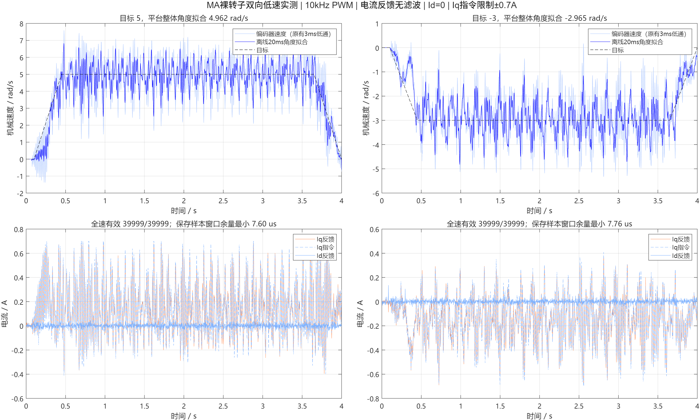

# MA 编码器恢复与 Id=0 双向转动实测

2026-10-19。开发机仍在 `test/foc_current`；当前 v11，未合入 main。
小车架空，MA 左侧无轮毂，MB 不输出 PWM。所有带电命令均有限时，最终已停止。

## 对当前使用目标的结论

电流反馈暂时保持无额外滤波，可以继续推进带轮及双电机验证。编码器速度沿用原有 3 ms 低通，IMU 的原有滤波也保留，不能把“电流不加滤波”理解为所有传感器都无滤波。

MA 已完成 Id=0 下的小电流正负脉冲，以及正向 5 rad/s、反向 −3 rad/s 各 4 秒的持续转动。方向与平均速度跟随符合预期，仍有明显的裸转子周期速度波动，尚不是平稳恒速或整车平衡验收。

## 编码器停更恢复

在开发机 ESP-IDF v6.0.2 的 `esp_driver_i2c/i2c_master.c` 中核查到：异步 NACK/超时路径不保证调用成功完成回调；原应用只在成功回调后再发起读取，没有超时重试，因此会一直停更。这解释了应用为何不能恢复；本轮未单独确认触发原始总线错误的电气原因。

修改 `sensor.cpp/.h`：

- 只有 `I2C_EVENT_DONE` 才发布有效完成通知，提交成功不等于测量成功。
- 记录未完成事务的发起时刻；等待超过 2 ms 时，在电机停止状态重建该总线及其队列，然后重新读取。
- 电机运行时仍保留 1.5 ms 左编码器新鲜度检查，先停机再允许恢复；不会自动重启电机。
- IMU 初始化写入等待改为最多三次尝试，避免无限等回调。
- 去掉回调里的重复 ISR yield，由 ESP-IDF 外层驱动统一处理。
- 新增健康计数及仅供测试分支使用的 `SENSOR_NACK` 诊断命令，运行时拒绝该命令。

验证：旧版本轮 4 次串口启动检查未复现故障，不能据此估算故障率；新版 8 次检查全部得到持续更新的左右编码器。其中一次右总线实际触发过恢复，随后恢复新数据。另在电机始终停止时，两次人为改用不存在地址造成 NACK，均验证恢复计数增长、编码器继续更新。记录为 `boots_before.*`、`boots_after.*`、`nack_recovery.*`。这些是串口打开/复位启动检查，不是实际断电重上电试验。

## 本轮调整与对照

1. `QZERO 0.10 240 2`：Id=0，正负 0.10 A 短脉冲；2399/2399 组窗口有效。各脉冲末段 Iq 约 +0.108/−0.104/+0.105/−0.118 A，Id 均值约 0–3 mA。
2. 最初速度 PI 为 0.04/0.2，Iq 指令限制 0.35 A。3 rad/s 测试出现转子停住、指令顶到限制，未达到持续转动要求。数据保存在 `speed3_initial.*`。
3. 将速度 PI 改为 0.12/0.4、限幅改为 0.7 A 后能连续转动。3 rad/s 平台拟合约 3.025 rad/s；这一步同时改变了两个条件，不能仅凭这一组对照认定所有停转都是电流限幅造成。
4. 保持速度参数不变，电流 PI 设计带宽从 200 Hz 提至 400 Hz。0.30 A 的 d 轴阶跃实测平台约 0.2991 A、标准差 14.2 mA，经验一阶拟合时间常数约 0.457 ms。旧 200 Hz 参数约 0.962 ms。拟合是闭环近似，不是电机 R/L 辨识或正式扫频带宽。
5. 相同 5 rad/s 短测中，电流 PI 提速使平台 Iq 跟踪误差 RMS 从约 26.1 降至 17.8 mA，但速度波动没有明显改善。
6. 单独比较速度 Kp：0.06、0.12、0.20。其 20 ms 窗口速度标准差约为 2.15、1.07、0.74 rad/s，因此保留 0.20；Ki 保持 0.4。不同次试验起始转角不同，统计是本次实测结果，不构成跨转角的最优参数证明。
7. 用保留参数做双向各 4 秒复测，覆盖多圈正向及反向机械运动。

## 最终双向 4 秒结果

平台统计窗口约 0.652–3.650 s；速度方向统一为 `-left_encoder.speed_rad_s`。平均速度以平台角度整体线性拟合得到；波动以离线 20 ms 局部角度拟合得到，这个离线处理不参与板上控制。

| 项目 | 正向 | 反向 |
|---|---:|---:|
| 目标速度 | +5 rad/s | −3 rad/s |
| 平台角度拟合速度 | +4.9616 rad/s | −2.9655 rad/s |
| 20 ms 窗口速度均值 | +4.9506 rad/s | −2.9514 rad/s |
| 20 ms 窗口速度标准差 | 0.7180 rad/s | 0.6724 rad/s |
| 20 ms 窗口速度范围 | 2.413～6.573 rad/s | −4.819～−0.908 rad/s |
| Id 平台均值 | +0.00051 A | +0.00018 A |
| Id 平台标准差 | 16.3 mA | 15.1 mA |
| 平台 Iq 跟踪误差 RMS | 58.9 mA | 47.7 mA |
| 缓存相电流最大绝对值 | 0.672 A | 0.647 A |
| 全速有效采样窗口 | 39999/39999 | 39999/39999 |
| PI 更新次数 | 39555 | 39530 |
| 最大 PI 更新时间间隔 | 300 μs | 300 μs |
| 错过比较值提交时隙 | 467 | 479 |
| 比较值 API 错误 / 保护停机 | 0 / 0 | 0 / 0 |

这两轮的 ADC 都持续 10 kHz 采样，但不能说 PI 严格每 100 μs 更新：自由循环偶尔漏过样本，按实际时间差更新，错过提交时隙则保留旧命令。保存样本的“所用采样→PWM 生效”约 69–270 μs；早先短测也出现过 370 μs。

4 秒缓存约每 20 组保存一组，即约 500 Hz；全速有效率来自 ISR 计数。500 Hz 缓存不能用于证明所有 10 kHz 样本的瞬时电流峰值。C 相为 −Ia−Ib 重构，未直接采样。电流安培换算仍基于标称增益，窗口仍是软件判定，未增加示波器验证。

运动中的 Iq 跟踪误差高于静止平台电流噪声，包含动态跟踪、限幅及调度延迟的影响，不能直接当作 ADC 随机噪声。当前继续保留无滤波电流反馈；后续先验证带轮工况、外环参数及另一路电机，再根据数据决定是否增加低通。



## 当前 v11 默认实验参数

```text
PWM frequency = 10 kHz
PWM counter resolution = 80 MHz
ADC trigger / PWM commit = TEZ +30 us / +80 us
Id reference = 0 for QZERO and SPEED
Current PI Kp = 0.060318579 V/A
Current PI Ki = 226.194672 V/(A*s)
Current feedback filter Tf = 0
Current-loop voltage vector limit = 0.12 V
Bench velocity PI Kp = 0.20 A/(rad/s)
Bench velocity PI Ki = 0.40 A/rad
Iq reference limit = +/-0.70 A
Encoder velocity LPF = original 3 ms
Software raw-current stop threshold = nominal +/-2 A
Encoder stale stop = 1.5 ms
Motor speed stop = 15 rad/s
```

速度外环只用于台架验证，未接入整车平衡控制。0.7 A 是指令限幅，2 A 是采样后的软件停机阈值，都不是硬件瞬时限流。当前 Id/Iq 正方向、电角度零位沿用首轮 MA 校准：`wrap(-7*encoder_angle-5.330672807)`。

## 文件与复现

`foc_current.cpp`、`sensor.cpp/.h` 是当前开发机源码副本；`before/` 保存 v8 和修改前传感器，`v9_before/`、`v10_before/` 保存关键中间版本。`prepare.py` 生成当前实验代码，并规范 LF 换行。源码规范换行后重建的固件 SHA256 与实际带电测试固件完全相同。

`run.py` 在开发机 IDF Python 下使用固定串口，先 STOP 并检查数据新鲜度；测试结束 STOP，确认停止后才 DUMP。所有 `.csv/.json/.log` 保留原始数据、ADC LUT、全速计数及健康记录。

MATLAB 离线分析不会启动电机：

```matlab
addpath('D:/code/Embedded-related/balance_car/esp32/current_loop/next_stage');
analyze_next('speed5_final4s');
analyze_next('speed_minus3_final4s');
compare_final;
```

对应 `.fig/.mat/.png` 可直接重开。最终固件 `tested_firmware.bin` SHA256：
`18719e18d9748933b1504f8a64e6cb604a2cdb804661aaed32dea838ac509378`。

下一阶段：独立校准带轮 MB 的电流极性、电角度零位和闭环，再比较装轮后的速度及双电机并行运行。本轮没有测试整车落地平衡。
