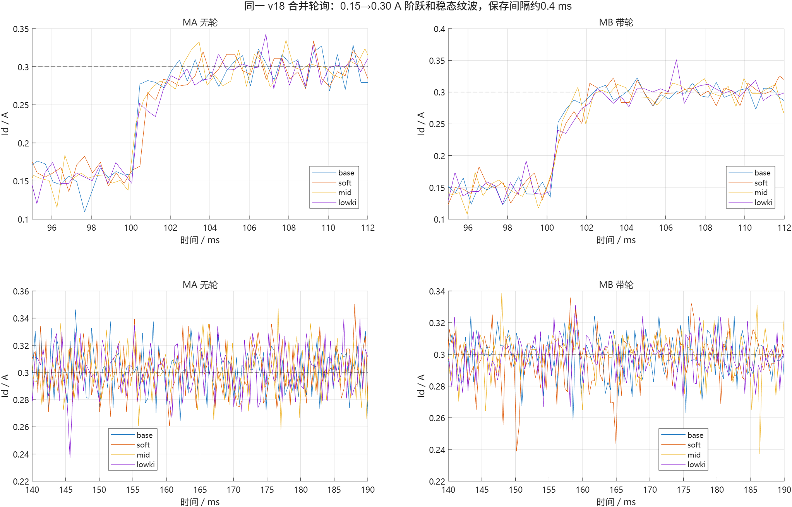
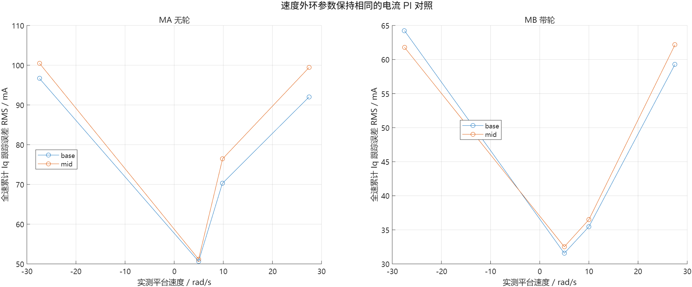
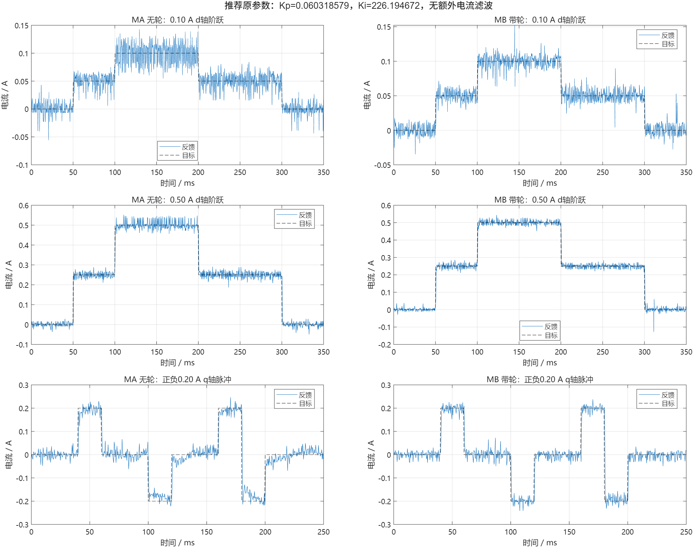

# 固定合并轮询后的电流 PI 参数实测

2026-10-19，开发机 `test/foc_current`，ESP-IDF v6.0.2，CPU160MHz。沿用用户确认的架空配置：MA无轮、MB带轮，两侧自由转动。本阶段用于探索电流环参数与实现路径，未合入main。

本轮推荐保留原参数：d/q均用 `Kp=0.060318579 V/A`、`Ki=226.194672 V/(A·s)`，无额外电流低通、D=0。降低PI没有显示足够的综合收益，不为改变参数而改变参数。这是一组在本次范围内可用的基线，不是全局最优或实测400Hz带宽的结论。

用户已确定采用v18的sensor＋FOC合并轮询。本轮通过既有GAINS命令设置参数，未修改、重编译或烧录固件；采样、调度、速度外环和保护保持一致。[迁移要点](迁移要点.md)单独列出后续提取到main时要一起保留的行为。

## 测试范围与统计口径

正式保存21轮：9轮0.30A候选阶跃（四组各两次，软档另有一次质量门槛未过的记录）、8轮速度对照、4轮原参数的电流幅值补测。另保留首轮成功运行但批处理误判退出码时的原始日志，不重复计入21轮。

- PWM10kHz，逐周期交替电机，每台名义5kHz采样；PI只消费新有效样本，按实际dt积分。
- 每次先STOP、确认传感器就绪、设置独立零位和参数；阶跃0.35秒、q轴脉冲0.25秒、速度每轮4秒，停止后才导出。
- 静止电流实验限幅 `min(0.12V, 0.015*Vbus)`；速度对照统一 `min(0.40V, 0.04*Vbus)`。所有轮次采用相同对应限幅，未提高既有实验上限。
- d轴阶跃由0到半幅、全幅、半幅、0，板上METRIC对140～190ms逐次有效PI累计。速度METRIC对1秒以后且处于匀速平台的区间累计。
- 阶跃和脉冲保存间隔约0.4ms，速度曲线约5ms；CSV可能混叠，不用稀疏曲线替代全速METRIC。
- q轴使用QZERO，即Id目标为0；四段±20ms短脉冲。其METRIC计数n=0，JSON中的零值不代表零误差。下表q指标采用保存样本，分别取45～59、105～119、165～179、185～199ms平台。

## 四组候选阶跃

| 标签 | Kp | Ki | MA Id标准差mA | MB Id标准差mA | MA/MB近似10～90%上升时间ms |
|---|---:|---:|---:|---:|---|
| base，原参数 | 0.060318579 | 226.194672 | 16.3～18.5 | 14.0～16.9 | 1.6～2.0 / 0.4～0.8 |
| soft，P/I减半 | 0.030159290 | 113.097336 | 15.6～17.6 | 13.4～27.1 | 1.6～2.8 / 1.2～2.0 |
| mid，P/I为原值75% | 0.045238934 | 169.646004 | 16.8～17.5 | 13.5～14.5 | 1.2～2.4 / 0.4～1.2 |
| lowki，仅I减半 | 0.060318579 | 113.097336 | 16.4～18.1 | 13.0～14.8 | 1.6 / 2.0 |

所有候选的0.30A平台均值为0.29979～0.30042A。上述范围包括质量门槛未过的soft记录，不隐藏不利结果。上升时间是0.15→0.30A阶跃首次穿越0.165/0.285A的保存样本估计，受约0.4ms分辨率和波动影响；不是严格整定时间、全速峰值或频响测量。保存曲线的单点尖峰也不直接当成确定的控制过冲。

软档和仅减I档没有稳定降低两台波动，MB响应更慢；中间档与原参数最接近，因此选择这两组继续速度对照。这里只测试了四组具体配对，不能把Kp/Ki上下界组成任意矩形范围并声明都已验证。



## 速度对照

速度外环固定Kp=0.20、Ki=0.40、Iq限制±0.70A，每档每组一次。两台在全部八轮均完成限时运行，无过流、过期数据或超速停机。平台速度由机械角度拟合得到。

| 目标rad/s | 原参数实测速度MA/MB | 原参数Iq误差RMS mA，MA/MB | 中间档Iq误差RMS mA，MA/MB | MA饱和率 原/中间档 |
|---:|---|---|---|---|
| 5 | 4.9730 / 4.9937 | 50.6 / 31.6 | 51.2 / 32.5 | 0 / 0 |
| 10 | 9.8099 / 10.0065 | 70.3 / 35.5 | 76.4 / 36.5 | 0 / 0 |
| +27.5 | 27.4603 / 27.5084 | 92.0 / 59.3 | 99.4 / 62.2 | 1.98% / 1.15% |
| −27.5 | −27.4342 / −27.5131 | 96.7 / 64.2 | 100.5 / 61.8 | 2.65% / 2.01% |

MB平台均未饱和。中间档稍降MA快速档饱和率，但总体Iq跟踪没有改善，原参数在MA上更一致。Iq RMS包含变化的速度外环目标所带来的动态跟踪误差，不能等同于恒定电流噪声或绝对电流标定误差。各档一次不能支持严格统计显著性或全工况最优判断。

模型轮半径32.5mm，27.5rad/s对应轮缘约0.894m/s，覆盖既有模型常规与快速参考范围；架空MB只体现轮组惯量和自身摩擦，未包含车体平动、滚阻或落地平衡。图中连线只是连接离散试验点。



## 原参数的电流幅值补测

| d轴目标A | MA均值A / 标准差mA | MB均值A / 标准差mA |
|---:|---|---|
| 0.10 | 0.099832 / 21.5 | 0.100162 / 10.3 |
| 0.30，两次范围 | 0.300096～0.300372 / 16.3～18.5 | 0.299796～0.300117 / 14.0～16.9 |
| 0.50 | 0.500097 / 23.0 | 0.499999 / 13.8 |

这些平台均未电压饱和。小电流时十几毫安的波动占比会明显上升，均值接近目标并不代表每个瞬时样本都接近目标，也不能区分真实纹波与测量误差。

| q轴脉冲幅值A | MA正/负平台均值A | MB正/负平台均值A | MA/MB保存平台误差RMS mA |
|---:|---|---|---|
| ±0.10 | +0.0997 / −0.1045 | +0.0984 / −0.1024 | 22.2 / 21.5 |
| ±0.20 | +0.1945 / −0.1846 | +0.1983 / −0.1972 | 20.6 / 16.7 |

q轴平台保存点未达到电压限幅。MA的0.20A短脉冲仍有动态偏差，不能写成与静止d轴同样精确；MA本轮峰值保存速度约6.88rad/s，MB约1.98rad/s，轮组惯量差异在加速度上可见。有限PI对快速变化反电势的跟踪、角度与采样误差等贡献未单独分离。



## 母线、保护与异常记录

21轮保存母线范围仅为7.974～8.067V。没有可控电源调压，本次没有完成例如6～8.4V的实物扫压；改变软件限幅不等于改变真实母线。动态限幅实现仍在使用，本报告只确认约8V附近的这些工况。未用仿真或旧数据补作宽电压实测结论。

合计MA有效181702/181729组，MB181750/181750组；最大有效PI间隔411μs，编码器最大年龄1010μs，均未放宽原1ms/1.5ms保护。全速原始A/B标称电流最大绝对值约0.714A；C相未直接采样。无比较器API错误、跨TEZ、过流或数据过期停机，保存电压命令没有超出当时上限。

`soft_d030_r1` 的MA有12组窗口拒绝，有效率约99.31%，低于预设99.5%批次门槛，故立即停止该批。相同参数复测全有效，反序复测也通过；没有放宽门槛或保护。部分拒绝发生在约10ms间隔的延后采样，根因未独立定位，不能认定为PI变小导致。soft另一次MB平台有单点尖峰，标准差升至27.1mA；原始数据完整保留。

首次批处理曾把CompletedProcess对象本身当作退出码，误判已正常完成的base记录；修正为.returncode后继续，相关原始日志为 `first_success_before_runner_fix.log`。这不涉及固件故障或保护修改。

最终已STOP并复位：v18、running=0、requested=0、zero_valid=[0,0]，母线8.031V。最后记录见 `final_stopped.json/.log`。源文件和固件哈希与本轮开始前相同：

```text
foc_current.cpp a3ca809fa2a8ea6f3fe81d160bbd2c6148a42a39b1d5779851518185498d8c32
sensor.cpp      a2715a24cb2ab58e2fee63cccbda52e975fec43eb03cc0425a547dc6858774bf
balance_car.bin 1e18d3630090170f852070ce64e3f7b59fa2f04d27361591e393cffa3cfbc1f6
```

## 文件与后续使用

- `selected_parameters.json`：推荐参数与已测范围；`evidence_summary.json`：包括失败质量门槛在内的汇总。
- 每轮CSV/JSON/LOG：保存样本、LUT、板上全速累计和串口原文；`*_analysis.json`是离线派生指标。
- `prepare_runner.py`从已有v18运行器加入GAINS设置；`run.py`、`sweep.py`是会连接实物并启动有限时实验的脚本。开发机运行环境为现有 `.platformio/penv/bin/python`，没有安装新依赖。
- `summarize.py`、`plot_results.m`只读已保存实验数据并写汇总或图，均不启动电机。PNG及MATLAB原生FIG已保存。

以这组PI继续作为main迁移候选即可。当前没有证据需要加D或额外电流低通，也没有必要继续修改任务划分。保留无仪器条件下的证据边界，但不把购置仪器作为继续本阶段探索的前提。
