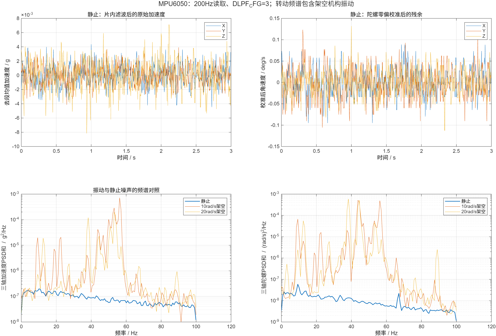

# 编码器与IMU原始数据、噪声和架空振动

2026-10-19。用户观看双电机演示后确认电流PI采用base档，并要求采集传感器数据用于仿真。本轮8段静止、2段转动记录，每段600个IMU同步快照，总计6000行；静止累计约24秒，记录之间有串口导出间隔，不是连续长时记录。

## 采集配置和当前实物状态

沿用车架架空、MA无轮、MB带轮。独立v24诊断固件增加原始计数与零偏记录，FOC仍使用base Kp=0.060318579、Ki=226.194672，无D、无额外电流低通，既有电流、角度过期和电压保护不变。v24复用原电流曲线缓冲区，禁止两个记录器同时写；实时控制仍读取独立反馈快照。数据缓存后在停止状态导出。

MPU6050：SMPLRT_DIV=4，DLPF_CFG=3，陀螺±500deg/s、65.5计数/(deg/s)，加速度±2g、16384计数/g；软件1000组静止陀螺校准、加速度权重0.02互补滤波。AS5600：4096计数/周，原速度低通3ms。

原始IMU整数已经做与固件相同的X/Y反号，坐标为X右、Y前、Z上；它们是片内DLPF之后、软件互补滤波之前的数据。CSV同时保留软件姿态角、编码器原始计数、角度、速度和各自I²C完成时间。IMU读取未使用DRDY同步，时间戳是I²C完成时间；统计代表整个当前读取链路。

## 静止结果

每段去均值后合并估计波动，避免把夹具姿态和段间缓慢变化当作随机噪声。

| 项目 | X / MA | Y / MB | Z |
|---|---:|---:|---:|
| 加速度标准差mg | 1.477 | 1.344 | 2.161 |
| 校准后陀螺随机标准差deg/s | 0.0331 | 0.0370 | 0.0312 |
| 编码器计数标准差 | MA：0 | MB：0.354 | — |

编码器一计数约0.08789°。MA在这次固定位置没有跨计数跳变，不等于其模拟噪声为零，也不能推广到所有转子位置。仿真两侧采用MB所见0.354计数作为共同的等效扰动候选，同时保留12bit量化；这是建模选择，不是两侧都测得0.354。

IMU间隔中位数5003μs，标准差88.6μs，范围4825～5156μs，约199.88Hz。编码器时间戳只是在约200Hz处取得的最新快照，不能据此重建每一次快速编码器事务的间隔；快照时编码器最大年龄MA/MB约205/218μs。

零偏校准后陀螺仍有约[0.0114,0.0095,0.0091]deg/s的平均残余。记录温度约35.74～35.96°C，数据不足以辨识长期漂移、温度模型或完整Allan参数。

## 不应被叫作随机噪声的异常

静止平均比力模长约0.8883g。单姿态不能区分各轴比例、零偏、安装姿态与器件误差，因此没有把偏离1g的部分塞进高斯噪声。仿真暂以0.8883共同加速度比例作为单姿态等效先验，并明确保留不确定性；这不是完成了六面加速度校准。

## 转动读数的波动

10和20rad/s各限时4秒，分析取起动1秒后的约400个样本。两台都正常限时停止。

| 工况 | 加速度三轴标准差mg | 陀螺三轴标准差deg/s |
|---|---|---|
| 10rad/s架空 | 6.77 / 14.79 / 39.55 | 1.604 / 0.624 / 1.836 |
| 20rad/s架空 | 5.10 / 12.01 / 26.57 | 1.668 / 0.382 / 2.032 |

频谱40～60Hz附近有显著峰值。10rad/s加速度波动比20rad/s大，不能假定振动随速度单调增加。这里包含夹具/车体的真实微动、架空共振、传感器及采样影响，没有外部运动参考，不能把它们全部认定为芯片电子噪声，也不能直接当成落地行驶的振动谱。

## 给仿真的参数

`sensor_noise_parameters.json`包含静止、10、20rad/s的协方差、一阶相关系数、AR12系数及相关创新、残余陀螺零偏和量化参数。AR12用于表示有色频谱；滤波极点限制在单位圆内。速度中间值通过稳定的滤波器输出混合，避免直接插值AR系数导致不稳定。只在0～20rad/s有实测锚点，外侧饱和使用20档，不能宣称更高速谱已验证。

仿真对真实惯性信号另加片内带宽的等效低通，再加入已在片内滤波后的经验噪声，不重复滤波同一噪声。然后使用原有0.02互补滤波。转动扰动是可切换的经验观测扰动，不额外当作物理外力重复施加。

完整统计见`analysis.json`，分析代码`analyze_sensor_noise.m`只读已保存数据，不连接电机。PNG及MATLAB原生FIG均保留。模型改动在独立managed worktree的`matlab/实测FOC/`，电流环实验分支仅保留硬件证据。

## 恢复与复现

已恢复原v18源码及原BIN/ELF并重新烧录。最后确认running=0、requested=0、zero_valid=[0,0]，母线8.193V，原固件SHA256仍为`1e18d3630090170f852070ce64e3f7b59fa2f04d27361591e393cffa3cfbc1f6`。见`restore_v18.log`及`sensor_capture_final_stopped.json/.log`。

`prepare.py`从本地v18生成诊断副本，`install_remote.py`先备份；`capture.py`会连接实物，默认只静止记录，`--moving`才增加已有限时和保护的10/20rad/s试验。`tested_recorder.bin`是诊断镜像，不替代已定稿的v18。最早诊断版本因额外连续内存分配不足而拒绝SREC，未启动电机；改用独占复用缓冲区后取得上述完整记录。
