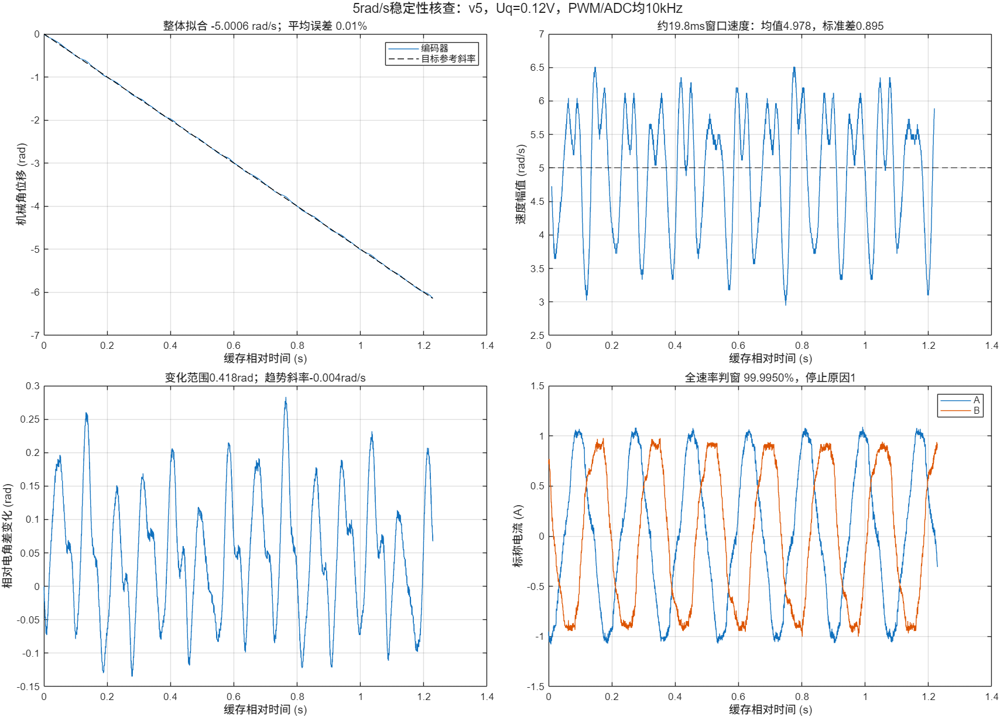

# 5rad/s是否稳定、能否继续测试（2026-10-19）

**可以继续用5rad/s做ADC窗口和原始电流质量核查。它能持续同步、整体速度接近目标，但存在明显的周期速度波动，尚不是严格恒速工况。**

已在当前v5硬件TEZ同步启动固件上实际补测，不再仅依赖旧v4结果。MA目标5rad/s，Uq=0.12V，PWM/ADC均10kHz，运行2秒，原有约2A软件阈值保持不变。正常到时，未触发故障，最终已确认停止。

## 当前实测

| 项目 | 结果 |
|---|---:|
| 稳定段角度整体线性拟合速度 | −5.0006rad/s |
| 相对目标幅值偏差（按整体拟合） | +0.0127% |
| 角度线性拟合R² | 0.999945 |
| 相对电角差变化范围 | 0.4183rad，约24°电角度 |
| 相对电角差趋势斜率 | −0.00449rad/s |
| 约19.8ms窗口速度幅值均值 | 4.978rad/s |
| 同一窗口速度标准差 | **0.895rad/s** |
| 同一窗口速度幅值最小/最大 | **2.944 / 6.510rad/s** |
| 同一窗口速度幅值5%/95%分位 | 3.409 / 6.121rad/s |
| 全运行10kHz判窗有效组 | **19,998 / 19,999（99.995%）** |
| 缓存段判窗有效组 | 4096 / 4096 |
| 缓存A/B标称电流绝对峰值 | 1.089 / 1.002A |
| 故障/比较值API错误/提交超期 | 均0 |

负号来自当前编码器方向。相对电角差取 `unwrap(命令电角度)+7×unwrap(编码器机械角)`；其波动有限且没有持续整圈累积，支持本次没有持续失步，不能理解为电角度零位已经标定。

速度幅值通过编码器角度在约20ms的居中差分窗口计算，不使用启动时可能有尖值的单个速度字段，也不把100μs间隔的直接差分当成准确瞬时速度。这个窗口仍观测到明显周期起伏，因此不能只凭整体拟合R²或均值接近5就宣称速度完全平稳。周期起伏的物理来源、编码器角度误差和采样时序影响尚未单独分离。



## 对后续测试的含义

- **当前ADC窗口核查：可以继续用5rad/s。** 每组窗口由实际生效比较值和转换起止判断，不依赖严格恒速。本轮全速率统计仍出现1组坏窗口，后续PI必须保留新有效组门控。
- **电流波形质量：可以用这个工况继续看原始波形、异常点和转角关联。** 分析同时保留实际编码器角度，不能把所有偏离理想定频正弦的部分都归成ADC噪声。
- **恒速性能或最终平衡控制验收：当前结果不足。** 真正的恒速控制需要进一步完成换相标定、电流闭环及编码器速度闭环；本轮开环转动未验证这些。

这次复测把稳定段采集拉长：从命令后700ms开始，在10kHz采样中每3组保存一组，4096组覆盖约1.2285秒、约6.84个命令电周期。ADC实际采样率没有降低；缓存保存率约3.333kHz，不能把它误记为4096组连续10kHz原始数据。全运行的19,999组判窗计数不抽点。

旧v4的5rad/s缓存整体拟合约−4.977rad/s，约20ms窗口速度范围约2.99～6.52rad/s、标准差约0.913rad/s；它同样是平均跟随而有周期波动。当前v5补测确认了这一判断，并验证本次同步启动没有导致保护停机。

## 文件与复现

数据：`ma_sync_012v_5rad_stability.csv/.json/.log`。

分析：`ma_sync_012v_5rad_stability_stability.png/.fig/.mat/.json`，以及原有 `_analysis.*` 和 `_summary.json`。

MATLAB：

```matlab
cd('D:/code/Embedded-related/balance_car/esp32/openloop_sampling')
analyze_speed_stability('ma_sync_012v_5rad_stability')
```

本轮命令 `RUN 0.12 5 2000 3 700`，未修改固件。仍为v5 `b47d488125627d452e5b1461635ab4e9d3562f0cd5921470378ff9bae54d57e3`，开发机在test/foc_current，默认停止。最终停止证据为 `pwm10k_sync_start/speed5_final_stopped.log`。

电流使用标称4A/V换算；判窗的2μs间隔尚未经示波器同步确认，本轮不构成高占空比、双电机或长时间验收。
