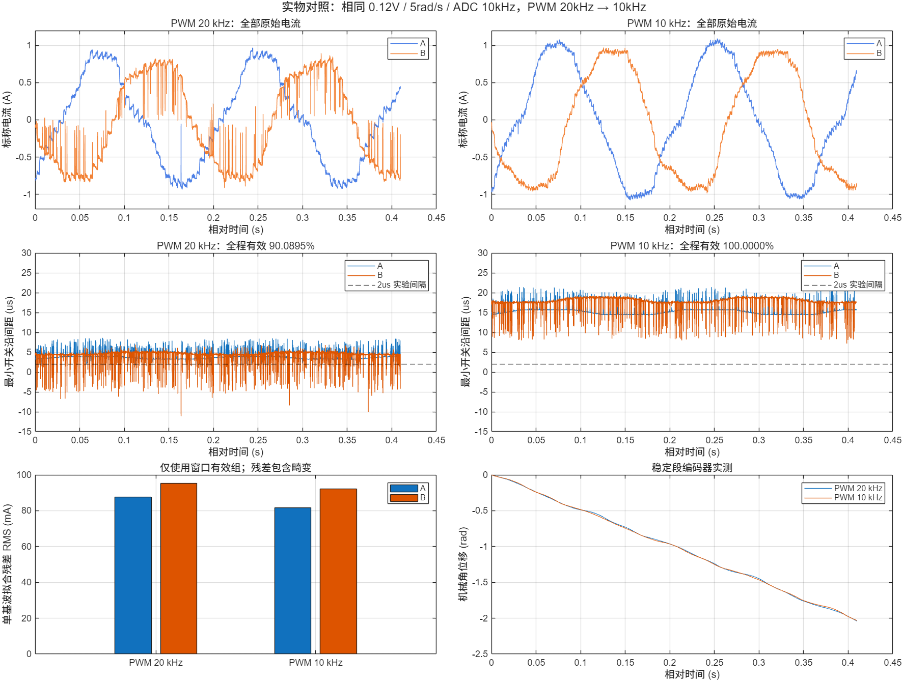

# PWM 20kHz → 10kHz 实物对照（2026-10-19）

**降至 10kHz 后，本轮 2 秒运行的 19,999 组全部满足低侧窗口检查；20kHz 基线为 90.0895%。MA 继续按目标转动，MB 不动。原始 B 相频繁向零跳变的尖点在 10kHz 图中明显减少。**

当前板上保留 10kHz 实验固件，已确认 `running=0/requested=0`，复位不会自动运行。开发机仍为 `test/foc_current`，改动未提交，未合入正式 main。

## 条件与结果

两轮都是 MA 无轮毂负载、MB 不输出 PWM、Uq=0.12V、机械目标 5rad/s、运行 2s，速度爬升 0.4s、电压爬升 0.15s。均从 900ms 起缓存 4096 组连续数据；**电流 A/B 采样率保持 10kHz**，母线约 1kHz。判窗均要求整个转换位于本相低侧区间内，离两端开关沿各留 2μs。

| 指标 | PWM 20kHz | PWM 10kHz |
|---|---:|---:|
| 主 PWM 周期 | 50μs | 100μs |
| 电流采样率 | 10kHz，隔 PWM 周期采 MA | 10kHz，每 PWM 周期采 MA |
| 全运行区间窗口有效组 | 18,017 / 19,999 | **19,999 / 19,999** |
| 全运行区间有效率 | 90.0895% | **100%** |
| 缓存 4096 组有效率 | 90.2100% | **100%** |
| A/B 至最近开关沿的最小间距（缓存内） | −3.1 / −11.1μs | **14.4 / 7.2μs** |
| A/B 间距中位数（缓存内） | 3.7 / 4.5μs | 15.3 / 17.8μs |
| AB 整段转换耗时中位数 | 16.7μs | 16.7μs |
| 原始样本间隔中位数 / 最大值 | 100 / 116μs | 100 / 111μs |
| 稳定段编码器拟合速度 | −4.994rad/s | −4.977rad/s |
| MB 缓存段编码器位移 | 0rad | 0rad |
| 母线 ADC 平均值 | 8.159V | 8.146V |
| A/B 电流基波拟合幅值，标称换算 | 0.836 / 0.828A | 0.998 / 0.975A |
| A/B 单基波拟合残差 RMS | 87.6 / 95.3mA | 81.8 / 92.2mA |
| A/B 全部原始点绝对峰值，标称换算 | 0.969 / 0.914A | 1.093 / 0.986A |
| 比较值 API 错误 / 提交超期 | 0 / 0 | 0 / 0 |
| 停止原因 | 正常到时 | 正常到时 |

10kHz 主周期还用 `Δus/Δcycle` 从缓存核对，中位数为 100μs。这是 MCU 时间戳与周期编号核对，没有用示波器直接测 GPIO。



## 怎样理解

降频主要解决了本次的**窗口容纳能力**。约 50% 占空比附近，20kHz 的逻辑低侧区间宽约 25μs；扣除两端各 2μs 后约 21μs，仅比 16.7μs 的 AB 转换整段多 4.3μs。10kHz 下相应区间约 50μs，扣除间隔后约 46μs，余量明显增加。

10kHz 中 A 开始位于 TEZ 后 40.0～50.5μs，B 结束位于 56.2～67.2μs。中断延迟仍有抖动；更宽的窗口吸收了本轮抖动，不能说降频消除了中断延迟。

原始 B 波形的明显尖点减少了，但对“已通过窗口的有效点”做相同单基波拟合，残差仅小幅下降。因此原先坏窗口点是原始尖点的重要嫌疑，剩余阶梯/谐波仍需继续分析。拟合残差包含畸变、转动不匀及噪声，不是纯 ADC 噪声或 THD。

另外，同一 Uq 指令下电流基波幅值增加约 18～19%。本次降频时保持定时器 10MHz 分辨率，因此半周期计数由 250 增至 500，单计数对应的相平均电压步长约从 32.6mV 降至 16.3mV；死区占周期的比例也变化。这些是电流幅值变化的可能因素，尚未分离验证，不能将两轮当作完全相同的实际相电压激励。

## 实现变化与复现

- 20kHz 源码及已测镜像保留在本目录根部；`tested_firmware.bin` 仍为原 20kHz 镜像，哈希 `6e5b7e5476b87ba4658d6997c4e597cbc30237c2b9b4b1eecb25fc349f0b452f`。
- 10kHz 源码/镜像单独保存在 `pwm10k/`。镜像哈希 `602e442babda09bd20cce9412587f5d798af23223ca08056031ca2c2fc14affe`。开发机也保留 `build/pwm20k_before_10k/` 可回退基线。
- 主定时器/采样定时器周期计数从 500 增至 1000。35μs 预触发由辅助定时器同步装载 150、向上数至 500 产生，实际 ISR 进入时间另行记录。
- 母线在 TEZ 附近每 10 个 PWM 周期采一次，与 35μs 的 MA 触发错开。MA 不再隔周跳过。
- 三相原子命令从每相 8bit 改为 10bit，仍在单个 32bit 字中发布；同时修改比较值编码/解码、初始 50% 比较值及判窗周期。避免半周期 500 时比较值被原 8bit 截断。
- ADC 转换和电流换算、2μs 判窗间隔、看门狗配置、限时启停、异常停止阈值、运行后导出方式保持同一方案。

MATLAB 复现：

```matlab
cd('D:/code/Embedded-related/balance_car/esp32/openloop_sampling')
compare_pwm
```

产生 `pwm20k_vs_10k.png/.fig/.json`；两轮各自的 CSV、校准 JSON、原始串口日志、FIG/MAT 和摘要已保存。`prepare_10khz.py` 从已测 20kHz 源码生成独立变体，不覆盖基线。

## 当前建议和边界

下一阶段可以先保留 **10kHz PWM + 10kHz MA 电流采样**，将判窗接入“新有效样本才更新 PI”，继续做模拟稳定时间及电流/编码器坐标标定。

本轮 100% 只覆盖这次低电压、小调制、单 MA、2秒运行；不是大占空比、双电机、长时间或电流闭环验收。电流仍用标称 4A/V 换算，2μs 间隔尚无示波器模拟波形确认。若恢复双电机隔周轮采且采样事件只随 10kHz PWM 发生，每台会变为约 5kHz，需要重新设计采样调度，不能沿用本轮 MA 的 10kHz 结论。
