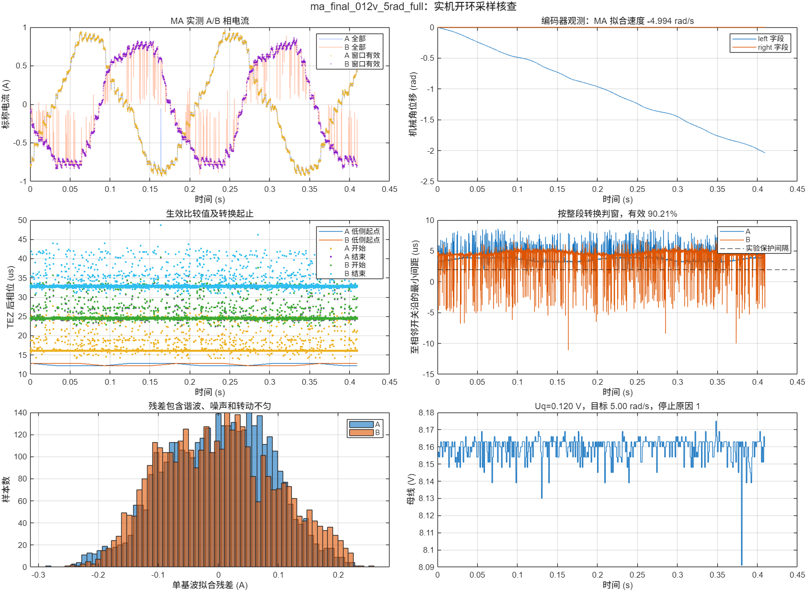

# MA 开环转动与 ADC 窗口实测（2026-10-19）

**后续更新：**已按用户要求完成 [PWM 20kHz → 10kHz 实物对照](PWM频率对比.md)。当前板上保留 10kHz 变体且已停止；新一轮全程窗口有效率为 100%（19,999/19,999）。以下主要记录此前的 20kHz 基线，不再代表最新板上镜像。

已在架空小车、MA 无轮毂负载、MB 保留轮子的条件下完成实际试转与 MATLAB 核查。MA 已能按开环目标转动，MB 未创建 PWM 输出。真实电机电流闭环尚未运行。

## 最终结果

最终固件：`6e5b7e5476b87ba4658d6997c4e597cbc30237c2b9b4b1eecb25fc349f0b452f`，文件 `tested_firmware.bin`。开发机 `/home/bgzerol/embedded_project/foc_balance_car` 处于 `test/foc_current`，基于 `c4556f1`，本轮三个源码文件保持未提交修改。正式 main 没有合并本实验。

| 项目 | 实测或软件核查结果 |
|---|---:|
| 开环 Uq / 机械目标速度 | 0.12 V / 5 rad/s |
| 最终运行时间 | 2 s，硬件定时中断到时停止 |
| 稳定段编码器拟合速度 | −4.994 rad/s |
| 稳定段 MB 编码器位移 | 0 rad（在编码器分辨率内） |
| 母线 ADC 估计 | 约 8.159 V |
| A/B 转换整段耗时中位数 | 8.4 / 8.3 μs |
| AB 整段耗时中位数 / 最大值 | 16.7 / 17.3 μs |
| 连续原始数据 | 4096 组，10 kHz，约 0.4096 s |
| 原始区间内 A/B 共同有效率 | 90.210% |
| 全运行区间共同有效率 | 18,017 / 19,999 = **90.0895%** |
| 全运行区间估计跨 TEZ 数 | 0 |
| 原始区间转换失败 / 饱和值 | 0 / 0 |
| 比较值 API 错误 / 提交超期 | 0 / 0 |
| 原始区间最大有效反馈间隔 | 301 μs |
| 停止原因 | 1：正常到时 |

正的开环角速度对应本分支 `left_encoder` 的负速度；这是本轮观察到的方向关系，尚未完成正式换相坐标标定。最终运行前后串口角度变化约 −9.035 rad；上表稳定段位移约 −2.039 rad。采样区间从命令后 900 ms 开始，填满缓存即停止写缓存，电机到 2 s 才停止。

## 电流波形质量

停止、不输出 PWM 的基线中，标称 A/B 电流标准差约 **11.5 / 14.1 mA**。最终稳定转动时，有效组的单基波拟合幅值约 **0.836 / 0.828 A**，拟合残差 RMS 为 **0.0876 / 0.0953 A**。全部原始点的绝对峰值约 **0.969 / 0.914 A**。

波形有明确周期，A/B 基波幅值接近；原始 B 相仍可见尖点，窗口筛选会剔除其中一部分。有效点也存在阶梯和畸变，不能宣称已达到干净正弦或完成电流环验收。单基波拟合残差包含谐波、转动不匀、测量噪声及可能的模拟恢复误差，不等于 ADC 纯噪声，也不是 THD。

电流使用实际 ADC 曲线校准查表，但 `5 mΩ × 50`、即 `4 A/V` 仍为硬件标称换算，未经外部电流表标定。当前 8.16 V、250 个半周期比较计数下，占空比一格对应约 32.6 mV 的相平均电压变化；0.12 V 小电压测试对量化和驱动死区比较敏感，这是波形阶梯的可能来源，尚未单独测量归因。



## 为什么 TEZ 前完成仍不够

本实验 PWM 在 TEZ 附近为高，向上计数到比较值时变低，向下计数到比较值时变高。周期 50 μs、计数分辨率 0.1 μs、半周期峰值 250。已生效比较值为 `C` 时，对应下桥的**逻辑低侧区间**为：

`[0.1 C, 50 − 0.1 C] μs`（相对主 TEZ）。

实验使用 2 μs 间隔，要求该相整个转换区间都在 `[0.1 C + 2, 48 − 0.1 C]` 内。A、B 分别判断，整组两者都有效才可供未来 PI 使用。

一个真实反例位于最终 CSV `us=1601661`：

- 当时已生效比较值 `A=128、B=127、C=122`。
- A 转换 `25.2 → 33.5 μs`，在 A 的保护窗口 `14.8 → 35.2 μs` 内。
- B 转换 `33.5 → 41.9 μs`；B 的逻辑低侧在 `37.3 μs` 结束，保护窗口在 `35.3 μs` 结束。
- AB 在下一 TEZ 的 `50 μs` 前完成，但 B 已越过自己的低侧区间。这组必须拒绝供给 PI。

主定时中断是三相比较值的唯一写者；core1 只发布一个包含三个比较值的 32 位完整命令。TEZ 回调追踪上一批排队比较值成为当前批，再把新三相写入下一 TEZ 的影子寄存器，避免任务逐相提交跨 TEZ。提交异常会停止。数据记录当前批比较值和周期编号；不是用新目标占空比推测当前窗口。

**证据边界：**这是 MCU 定时器、转换前后软件时戳及已生效比较值的核查，没有示波器同步测得栅极、分流电阻和 ADC 采样保持孔径。2 μs 是本轮实验间隔，尚未证实足以覆盖所有运放恢复过程。DRV8300 MODE=PVCC、DT 悬空来自 PCB 网络核对；TI 文档说明 MODE 接 GVDD 时 INL 反相、DT 悬空典型死区 200 ns，仍不能替代实板波形测量。

## 固件行为与测试顺序

- MA：GPIO35/34/33；MB：GPIO12/11/10 保持输入下拉。GPIO7 维持电源。
- 上电默认等待串口命令。开环积分电角度，7 极对数，速度在 0.4 s 内爬升，电压在 0.15 s 内爬升；电流 PI 不参与输出。
- core1 运行合并的 sensor/openloop 自由循环任务、优先级 5、保留 yield；延续关闭 Idle1 TWDT 的实验配置。
- core0 定时器中断采 MA 的 A/B，每相约 10 kHz；母线约 1 kHz，按实际观察到的 MA 周期奇偶安排到另外一周期。**这个空闲周期仅存在于本轮 MA 单电机实验，不能照搬成双电机结论。**
- MA 预触发从 TEZ 后 13 μs 调到 11 μs。同时减少不变比较值的重复写入。中断进入相位仍有明显抖动，最终 A 开始约 13.9～32.0 μs，B 结束约 30.7～48.7 μs。
- 硬性单次时间上限 4 s，电压上限 0.8 V、目标速度绝对值上限 20 rad/s。实测始终只用了 0.12 V、2 或 5 rad/s。
- 控制心跳超过 3 ms、母线采样过旧/估计越界、ADC 失败/饱和、标称相电流超过约 2 A、提交超期时停止。软件阈值没有经过保护系统认证或实物注入故障验收；不能替代硬件限流。
- 停止为强制三路 PWM 低电平，对该接法是低侧制动零矢量，**不是所有栅极关断**。右侧不启用调制。
- ISR 只缓存数据，电机停止后才输出 LUT 和 CSV。没有运行中流式打印原始采样。

历史数据：`ma_012v_2rad` 为 13 μs 触发，抽点样本有效率 82.235%；`ma_tuned_012v_2rad` 为 11 μs，抽点有效率 90.798%；`ma_tuned_012v_5rad` 为长稳定段抽点数据。抽点与 PWM 周期可能相关，不能用这些比例替代全速率统计；最终 `ma_final_012v_5rad_full` 提供未抽点原始段及全运行速率计数。

`baseline` 来自第一版严格提交预算诊断，未输出 PWM；其中 `reason=4/late_commit` 是当时过窄提交预算的历史诊断结果，不是最终固件结果。最终固件未复用该错误预算。

## 复现与文件

在 MATLAB 中执行：

```matlab
cd('D:/code/Embedded-related/balance_car/esp32/openloop_sampling')
analyze_openloop('ma_final_012v_5rad_full')
```

生成 `_analysis.fig`、`_analysis.mat`、`_analysis.png`、`_summary.json`。FIG 可继续缩放查看，MAT 保留表格、校准、换算电流与判窗结果。

`prepare.py` 从已验证 ADC 基线和 `experiment.inc` 生成实验源码，拷入开发机实验工程 `user_lib/` 的三个同名文件后，用该工程既有 IDF v6.0.2 python3 工具链构建。`run.py/flash.py` 在开发机 `esp32/balance_car/build/openloop_experiment/` 下运行，使用稳定串口 by-id；`flash.py` 会烧写程序，所以只在准备重现试验时使用。

```sh
# 只查询并明确停止
python3 run.py check --peek
# 实际驱动 MA：0.12 V、5rad/s、2秒，从900ms开始保留连续数据
python3 run.py capture --v 0.12 --speed 5 --ms 2000 --decimate 1 --start 900
```

上面的 python3 需要使用 IDF 虚拟环境中带 pyserial 的可执行文件。每次运行脚本都会先发 STOP。串口原始 `.log`、`.csv`、ADC 查表 `.json` 和数值摘要均保存在本目录。原始串口日志是未解析证据；`before_physical_app.bin` 为本轮烧写前从板上 0x10000 读取的 1 MiB 应用分区，开发机也保留 `build/openloop_before/` 的源码和镜像。回退应用需按原偏移 0x10000 写入，并单独确认当时程序的启动行为。

## 下一步

1. 将本轮逐相判窗接到此前的“新有效样本才更新 PI”路径；坏组保留旧反馈和旧序号，统计最长有效反馈间隔并定义过旧停止。开环本身不依赖电流，所以本轮没有用坏点闭环调制。
2. 缩短或稳定采样链路，进一步分析延迟的中断来源；当前约 10% 的组仍在低侧窗口外。双电机恢复后需要重新安排母线采样，不能假定还有空闲轮次。
3. 实测驱动/分流电阻波形、验证模拟稳定间隔，并完成电流增益/符号、编码器方向、电角度零位标定；之后再做 MA 的小电流阶跃闭环。

参考：[TI DRV8300 数据手册](https://www.ti.com/lit/ds/symlink/drv8300.pdf)。原作者工程保持只读。
