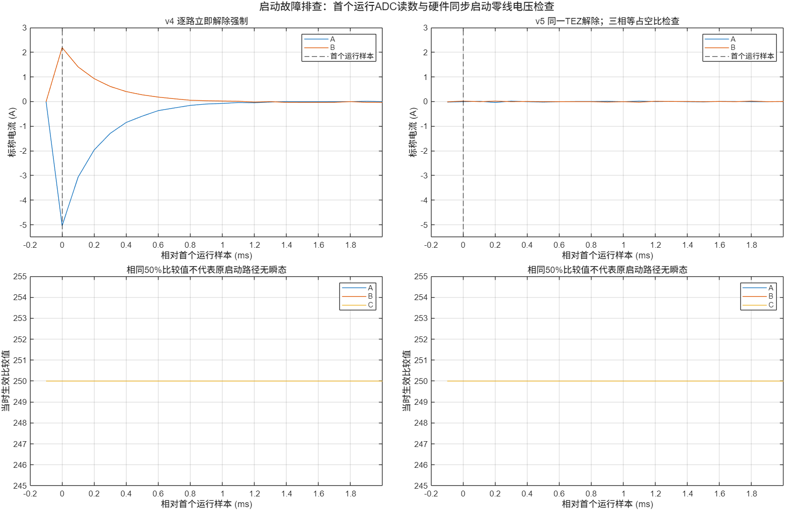

# Uq升至0.20V、目标20rad/s：保护停机与启动修正（2026-10-19）

**已实际升至0.20V重测。修正三相同步启用后，电机加速至约8.4rad/s时，在命令后170.850ms触发原有约2A阈值，未完成20rad/s稳态试验。当前已明确停止，限流阈值没有放宽。**

## 最新一轮结果

PWM和MA采样仍为10kHz，目标20rad/s，Uq=0.20V，速度爬升0.4秒、电压爬升0.15秒，最长运行2秒。缓存改从启动时刻开始，同时增加不依赖缓存起始时间的故障原始样本快照。

| 项目 | 同步启动后的实测/记录 |
|---|---:|
| 固件版本 | v5，硬件TEZ同步解除强制 |
| 停止原因 | 6：电流读数越过阈值 |
| 故障时刻 | 命令后170.850ms |
| 当时爬升中的机械速度命令 | 约8.54rad/s，尚未到20 |
| 故障附近编码器速度字段 | −8.40rad/s |
| 故障A/B电流，标称换算 | **−2.013852 / +1.035672A** |
| 运行段A/B原始点绝对峰值 | 2.014 / 1.900A |
| 运行采样组/判窗有效组 | **1708 / 1708** |
| 故障三相已生效比较值 | 261 / 247 / 239，半周期峰值500 |
| 故障A转换区间 | TEZ后40.1～48.5μs |
| 故障B转换区间 | TEZ后48.5～56.8μs |
| 故障标志 | 63：运行、两次转换、逐相判窗和周期检查均通过 |
| 比较值API错误 / 提交超期 | 0 / 0 |

数据为 `ma_sync_020v_20rad_start.csv/.json/.log`。注意：4096组缓存中只有前1708组处于运行，后面的零电流是保护停止后的记录，不能将整段拟合速度或电流幅值当成20rad/s稳态指标。

约2A是按标称4A/V换算的**软件停机阈值**，不是硬件瞬时峰值钳位；电流尚未经过外部仪表增益校准。这次保护有效执行，不等于已经完整验证保护系统。

## 本轮还发现并修改了启动路径

最初沿用v4逐路立即解除强制低电平的路径，0.20V试验约0.17秒保护停机；由于原缓存从900ms才开始，当时未捕获触发点。随后同条件重采启动段，又捕获到首个运行样本异常：

- 三相记录的已生效比较值均250，即50%共同占空比。
- A/B原始ADC为394/2551，按本轮标称换算约为 **−5.040 / +2.189A**。
- 前一采样尚未启用PWM，读数接近零点；紧随其后的样本出现衰减过程。

这不能简单解释为“为了20rad/s需要更高电压”。既有源码逐路调用 `mcpwm_generator_set_force_level(g,-1,true)`，本机IDF v6.0.2的LL实现会把 `gen_cntuforce_upmethod` 设为0，即立即生效；三相不保证在同一硬件时刻解除。这个路径会带来启动瞬态嫌疑。软件比较值和低侧判窗记录本身不能证明解除强制那一刻的实际三路GPIO/栅极状态。

v5修正为：在前一TEP后的有余量区间，向本实验占用的operator0/1一次性写入各自的强制模式影子寄存器，并将更新方式设为TEZ；三相均在**同一个下一TEZ**解除强制，主TEZ回调再标记进入运行。异常停止仍采用立即强制低电平，并取消未生效的启用请求。

另外新增独立故障样本，保留原始ADC、转换起止、生效比较值和相对命令时刻，避免未来缓存错过故障后只能看到停机零电流。

参考：[Espressif MCPWM强制输出接口说明](https://docs.espressif.com/projects/esp-idf/en/stable/esp32/api-reference/peripherals/mcpwm.html#generator-force-actions)。S3寄存器定义及本机LL源码核对了：`GENn_CNTUFORCE_UPMETHOD=0`为立即、bit0为TEZ。具体实现以本机IDF v6.0.2的 `esp_hal_mcpwm/esp32s3/include/hal/mcpwm_ll.h` 和 `soc/esp32s3/register/soc/mcpwm_reg.h` 为依据。

## 同步启动检查

在重跑0.20V前，先用 `Uq=0.001V、ω=0、500ms` 做三相等占空比检查。0.001V小于当前比较值量化步长，实际三相都保持250/500，即共同50%PWM、理想线电压为零。

- 正常到时，没有触发过流，编码器角度没有变化。
- 缓存内A/B标称电流标准差约10.8/11.6mA，原始绝对峰值约0.158/0.063A。
- 4999组运行采样中4996组通过窗口判断；仍有少量延迟异常，后续电流闭环必须保留判窗门控。
- 随后的0.20V复测没有重现首个运行样本的大电流读数；它是在已加速约0.171秒后、有效窗口内达到约2A阈值。

以上支持保留同步启用修正，但没有用示波器直接验证三相GPIO/栅极解除瞬间；不能仅靠这两次结果断言此前大读数的全部根因已经证明。

## 当前结论与后续方向

0.12V/20rad/s此前是持续失步；0.20V在本轮加速早段能跟随约8.5rad/s的斜坡，但先达到现有电流阈值。**目前约束已经包含启动/加速电流，继续单独升压不能保证完成20rad/s测试。**

后续应把初始对齐、电压爬升与速度爬升共同安排，并校准电流后再确定允许的阈值；也可以进入正确标定的电流闭环，通过可控转矩加速。不能通过滤波隐藏触发点，也没有在本轮提高保护阈值来强行继续。

## 版本、文件与复现

- 开发机仍为 `test/foc_current`，本轮源码修改未提交，正式main未合入。
- 当前板上v5已测固件：`b47d488125627d452e5b1461635ab4e9d3562f0cd5921470378ff9bae54d57e3`。
- 源码和镜像：`pwm10k_sync_start/`，生成脚本 `prepare_sync_start.py`。
- v4源码/镜像仍在 `pwm10k/`；开发机备份为 `build/pwm10k_before_sync_start/`。
- `ma_pwm10k_020v_20rad_full`：v4第一次保护停止，900ms以后缓存，不包含运行触发段。
- `ma_pwm10k_020v_20rad_start`：v4首个运行采样异常，包含启动瞬态。
- `ma_sync_zero`：v5共同占空比启停检查。
- `ma_sync_020v_20rad_start`：v5升压复测，包含170.850ms故障样本。
- `compare_pwm_startup.m`、`compare_openloop_voltage.m` 产生原生FIG、MAT和PNG。跨版本图中0.12V为900ms后缓存，0.20V为启动缓存，不能直接做稳态噪声优劣比较。
- 最终停止日志：`pwm10k_sync_start/voltage20_final_stopped.log`。
