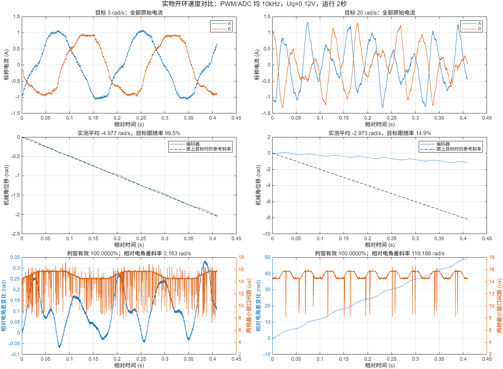

# 开环目标 5 → 20rad/s 实物对照（2026-10-19）

**已发送并执行 20rad/s 目标，2秒后正常停止。保持 Uq=0.12V 时，转子未跟上目标，缓存区间平均拟合速度约 −2.973rad/s；相对电角差持续累积，确认该次试验存在失步。ADC 低侧判窗仍为 100%。**

本次未修改或重新烧写固件，仅改变串口 RUN 命令的速度参数。仍为 PWM/MA ADC 均 10kHz 的 v4 固件，哈希 `602e442babda09bd20cce9412587f5d798af23223ca08056031ca2c2fc14affe`。开发机保持 `test/foc_current`。最终明确查询到 `running=0/requested=0`，上电或复位不会自动运行。

## 条件与指标

同样 MA 无轮毂负载，MB 不启用 PWM；Uq=0.12V，运行2秒，电压爬升0.15秒、速度爬升0.4秒；从900ms起保存4096组连续10kHz数据。把目标从5改到20，意味着同一爬升时间内机械角加速度由12.5增至50rad/s²，不能将这次试验视为已充分缓慢加速至20rad/s的速度上限测试。

| 指标 | 目标5rad/s | 目标20rad/s |
|---|---:|---:|
| 缓存区间编码器平均拟合速度 | −4.977rad/s | **−2.973rad/s** |
| 实际速度幅值/目标 | 99.53% | **14.86%** |
| 缓存区间机械角变化 | −2.033rad | −1.155rad |
| 命令电角速度拟合 | 约35rad/s | **约140rad/s** |
| 相对电角差变化斜率 | 0.163rad/s | **119.189rad/s** |
| 全程窗口有效组 | 19,999/19,999 | **19,999/19,999** |
| A/B 最小开关沿间距（缓存内） | 14.4 / 7.2μs | 14.4 / 8.1μs |
| AB 转换整段中位数 | 16.7μs | 16.7μs |
| 原始采样间隔中位数 / 最大值 | 100 / 111μs | 100 / 110μs |
| A/B 原始电流绝对峰值，标称换算 | 1.093 / 0.986A | **1.319 / 1.325A** |
| A/B 单命令基波拟合残差RMS | 81.8 / 92.2mA | **336.7 / 347.4mA** |
| 母线 ADC 平均值 | 8.146V | 8.136V |
| 比较器API错误 / 提交超期 | 0 / 0 | 0 / 0 |
| 停止原因 | 正常到时 | 正常到时 |

正的开环命令对应当前左编码器的负方向。表内平均拟合速度来自约0.4096秒缓存区间，不代表整个2秒的瞬时速度都相同；20rad/s图中机械运动明显不匀。



## 如何确认没有跟上

沿用5rad/s测试确认的方向关系、7极对数，观察 `unwrap(命令电角度)+7×unwrap(编码器机械角)`。正确同步时，该量可以随负载有有限波动，但不应持续积累整圈电角差。

20rad/s测试中，命令电角度确实以约140rad/s前进，编码器仅约−2.973rad/s。相对电角差在缓存区间变化约49.25rad，约7.84个电周期，斜率约119.19rad/s。这支持实际转子未与旋转磁场保持同步，而不是仅仅编码器方向符号相反。

因此：**速度参数改到了20，不等于电机已经达到20。** 同时，电流判窗全有效而波形仍明显畸变，说明不能把本轮电流变化简单视作ADC尖点并靠滤波消除。失步状态的单基波拟合残差也不能当成纯测量噪声。

低电压下可用转矩、反电动势及加速需求都可能参与其中；本轮没有分离这些因素，不能断言唯一原因是电压不足，也不能据此判定10kHz或电机硬件无法达到20rad/s。若继续排查，应分别改变爬升时间和驱动电压，而不是一次同时改多个条件。本次没有额外提高驱动电压或延长运行。

## 数据与复现

- 本轮数据：`ma_pwm10k_012v_20rad_full.csv/.json/.log`。
- 本轮分析：同名前缀 `_analysis.png/.fig/.mat`、`_summary.json`。
- 对比：`speed5_vs_20.png/.fig/.json/.mat`，脚本 `compare_openloop_speed.m`。
- 原始校准查表来自本次启动；电流使用标称4A/V，2μs保护间隔仍是软件判窗条件，尚无示波器模拟孔径/恢复过程验证。
- 本次RUN期间右编码器字段持续为0；最终复位后恢复到此前约0.989rad。本轮不以该字段作为右轮运动/采样健康的独立证明，后续双电机前需要检查其初始化和数据有效性。MB始终没有PWM输出。

MATLAB：

```matlab
cd('D:/code/Embedded-related/balance_car/esp32/openloop_sampling')
compare_openloop_speed
```

本次串口命令为 `RUN 0.12 20 2000 1 900`；使用原 `run.py` 会先查询停止状态，试转结束后再导出数据。最终停止日志保存在 `pwm10k/speed20_final_stopped.log`。
